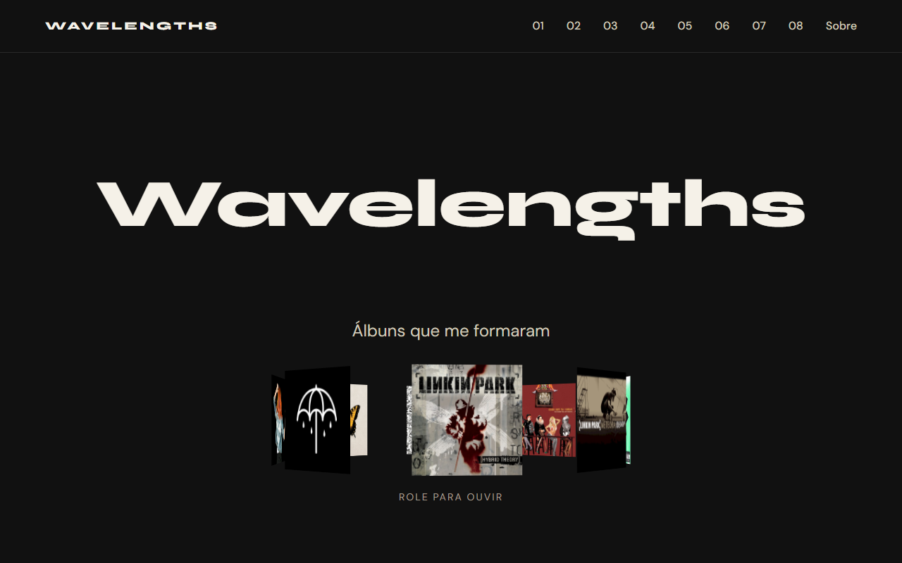

# Wavelengths · Álbuns que me formaram

Página de estudo da Fase 1 do portfólio (HTML + CSS). Ela apresenta álbuns que marcaram minha formação e é construída etapa por etapa, um conceito por commit, para ser usada em aula.

## No ar

[wavelengths-renanferreira-dev.vercel.app](https://wavelengths-renanferreira-dev.vercel.app)

## Como abrir

Não precisa instalar nada: abra o arquivo `index.html` no navegador.

Para ver a página como ela estava em uma etapa, use `git log --oneline` e depois `git checkout <hash>`. Para voltar ao fim do projeto, `git checkout main`.

## Etapas

- `00-ponto-de-partida`: esqueleto do documento HTML.
- `01-estrutura-semantica`: header, nav, main, sections, footer e o conteúdo dos álbuns.
- `02-imagens`: capas com `img`, `alt`, `width` e `height`.
- `03-seletores`: `style.css` com seletores de tag, classe, id e descendente.
- `04-pseudo-classes`: `:hover` e `:focus-visible`.
- `05-cascata-e-heranca`: herança a partir do `body`, `inherit` e especificidade.
- `06-box-model`: `margin`, `padding`, `border` e `box-sizing`.
- `07-cores-e-tipografia`: paleta com contraste conferido e fontes do Google Fonts.
- `08-variaveis-css`: `--color-accent` próprio de cada álbum.
- `09-flexbox`: header, menu, etiquetas de gênero e clima do álbum em linha.
- `10-grid`: layout do hero e de cada álbum, com a capa alternando de lado.
- `11-css-nesting`: o `style.css` reescrito com CSS nesting nativo.
- `12-transition`: hover e foco do cabeçalho mudam aos poucos com `transition`.
- `13-keyframes`: o hero vira um carrossel 3D girando com `@keyframes`, parado para quem prefere menos movimento.

## Pontos de atenção

### Onde costuma travar

- `02-imagens`: o caminho da imagem diferencia maiúsculas de minúsculas no servidor. `covers/Meteora.jpg` abre no seu computador e quebra no ar se o arquivo se chama `meteora.jpg`.
- `02-imagens`: capa decorativa leva `alt=""`, não fica sem `alt`. Sem o atributo, o leitor de tela lê o nome do arquivo.
- `05-cascata-e-heranca`: nem tudo é herdado. `color` passa do `body` para os filhos, `background-color` não, e links ignoram a cor herdada até receberem `color: inherit`.
- `05-cascata-e-heranca`: "a regra que vem por último vence" só vale com a mesma especificidade. Uma classe vence uma tag mesmo vindo antes no arquivo.
- `06-box-model`: sem `box-sizing: border-box`, o `padding` soma na altura e o hero passa dos 760 px.
- `07-cores-e-tipografia`: se o peso 700 da fonte não foi baixado, o navegador inventa um negrito borrado. Use só os pesos que o link do Google Fonts traz.
- `08-variaveis-css`: a variável é declarada no álbum e lida nos filhos. Se `--color-accent` ficar no elemento errado, a cor não chega aonde precisa.
- `09-flexbox`: `display: flex` vai no pai, não nos itens que você quer alinhar.
- `10-grid`: `grid-template-areas` só posiciona filhos diretos. Foi por isso que o texto de cada álbum ganhou a `div` `album-info`.
- `11-css-nesting`: um espaço muda tudo. `&.album-reverse` é o mesmo elemento com as duas classes; `& .album-reverse` é um filho.
- `12-transition`: a `transition` fica no estado normal, não no `:hover`. No `:hover`, a animação só acontece na ida.
- `12-transition`: `text-decoration` não tem meio-termo e não anima; quem anima é `text-decoration-color`.
- `13-keyframes`: `perspective` vai no palco parado e `transform-style: preserve-3d` no carrossel que gira. Trocar os dois achata o 3D.
- `13-keyframes`: sem `prefers-reduced-motion`, quem pediu menos movimento no sistema continua vendo o giro.

### O que eu faria diferente

- Faria o deploy na Vercel na primeira versão que abre no navegador, não no fim. Problemas de caminho e de maiúsculas aparecem cedo e são fáceis de corrigir. Essa virou regra dos próximos projetos.
- Os dados dos oito álbuns se repetem no HTML: para trocar um álbum, mexe-se em vários lugares. No Wavelengths Remastered (Fase 2), eles vão para um `albums.json` lido com JavaScript.
- A página foi pensada para telas de 1280 px. Uma versão para celular seria o próximo passo.

## Navegadores

A partir da etapa `11-css-nesting`, o `style.css` usa CSS nesting nativo, suportado no Chrome 120+, Firefox 117+ e Safari 17.2+. Em navegadores mais antigos, as regras aninhadas são ignoradas e a página perde parte do estilo.

## Créditos das capas

As capas ficam na pasta `covers/`, em baixa resolução (500 × 500 px), só para fins educacionais. Os direitos pertencem aos artistas e às gravadoras. As imagens vêm do [Cover Art Archive](https://coverartarchive.org/), via MusicBrainz.

- `hybrid-theory.jpg`: *Hybrid Theory* (2000), Linkin Park. Gravadora: Warner Bros. Records.
- `meteora.jpg`: *Meteora* (2003), Linkin Park. Gravadora: Warner Bros. Records.
- `blink-182.jpg`: *blink-182* (2003), blink-182. Gravadora: Geffen Records.
- `a-fever-you-cant-sweat-out.jpg`: *A Fever You Can’t Sweat Out* (2005), Panic! at the Disco. Gravadoras: Decaydance e Fueled by Ramen.
- `riot.jpg`: *Riot!* (2007), Paramore. Gravadora: Fueled by Ramen.
- `brand-new-eyes.jpg`: *Brand New Eyes* (2009), Paramore. Gravadora: Fueled by Ramen.
- `paramore.jpg`: *Paramore* (2013), Paramore. Gravadora: Fueled by Ramen.
- `thats-the-spirit.jpg`: *That’s the Spirit* (2015), Bring Me the Horizon. Gravadora: RCA Records (Sony Music).
## Licença

Código sob a licença MIT. Veja o arquivo [LICENSE](LICENSE).
